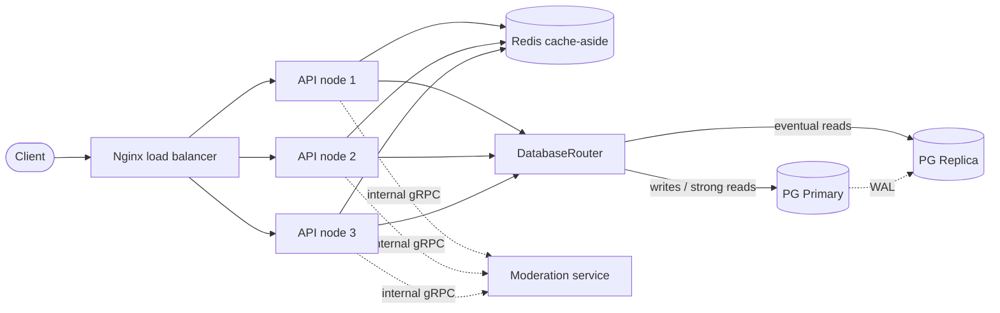

# PulseStream

**A distributed, high-throughput discussion backend, built step by step to practice real system design.**

> **Status: under active development.** The distributed primitives and the database infrastructure are done. The application layer (API, caching, extra protocols, load-balanced deployment) is in progress. Not production-ready.

Detailed notes for every change, decision, and experiment live in [`docs/`](docs/).

---

## What it is

PulseStream is the backend for a comment section: users post comments, edit them, delete them, and reply. The feature set is small on purpose. The goal is to build it the way large systems are built, and to apply the underlying concepts instead of only reading about them:

- Stateless API servers behind a load balancer
- Read/write splitting across a PostgreSQL primary and a streaming replica
- Horizontal table partitioning
- Redis cache-aside layer
- Snowflake distributed IDs
- Consistent hashing and tunable quorum consensus (`W + R > RF`)
- REST, GraphQL, WebSockets, and gRPC

## Status

| Area | Status |
|---|---|
| Snowflake IDs, consistent hashing, quorum simulator | Done |
| PostgreSQL primary + streaming replica, Redis (Docker Compose) | Done |
| Partitioned `comments` schema with JSONB | Done |
| Data access layer and REST API | In progress |
| Redis cache-aside | Planned |
| GraphQL, WebSockets, gRPC | Planned |
| 3 API containers behind Nginx | Planned |
| OpenAPI spec, benchmarks, final diagrams | Planned |

## Architecture

Target design (parts of it are not built yet):



## Tech stack

Python, FastAPI, PostgreSQL 16, Redis 7, Docker Compose, Nginx (planned), pytest.

## Getting started

Requires Python 3.11+ and Docker.

1. Create a `.env` file next to `docker-compose.yml`:
   ```
   POSTGRES_PASSWORD=change_me_primary
   REPLICATION_PASSWORD=change_me_replication
   ```
2. Start the infrastructure and wait until all services are healthy:
   ```bash
   docker compose up -d
   docker compose ps
   ```
3. Apply the schema:
   ```powershell
   Get-Content infra/schema.sql | docker compose exec -T pg-primary psql -U postgres -d pulsestream
   ```
   ```bash
   docker compose exec -T pg-primary psql -U postgres -d pulsestream < infra/schema.sql
   ```
4. Run the tests:
   ```bash
   pip install pytest
   python -m pytest tests -q
   ```

Stop with `docker compose down` (add `-v` to wipe all data).

## Project structure

```
pulsestream-engine/
├── docker-compose.yml
├── infra/          # database setup scripts and schema
├── src/            # application and distributed modules
├── tests/
└── docs/           # detailed notes and decisions
```

## Roadmap

- [x] Snowflake ID generator
- [x] Consistent hashing ring
- [x] Quorum simulator
- [x] PostgreSQL primary and streaming replica
- [x] Partitioned schema with JSONB
- [ ] Data access layer and REST API
- [ ] Redis cache-aside
- [ ] GraphQL, WebSockets, gRPC
- [ ] 3 API containers behind Nginx
- [ ] OpenAPI spec, benchmarks, final diagrams